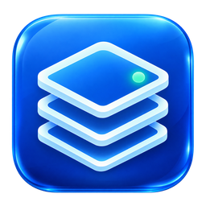
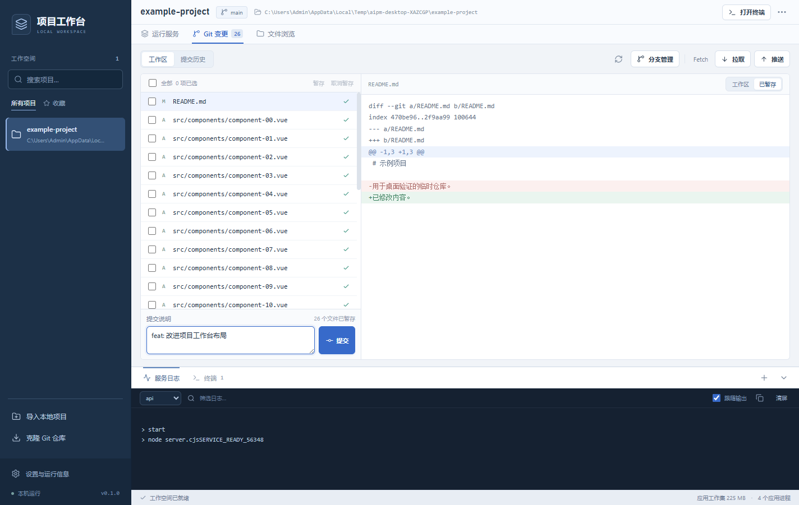
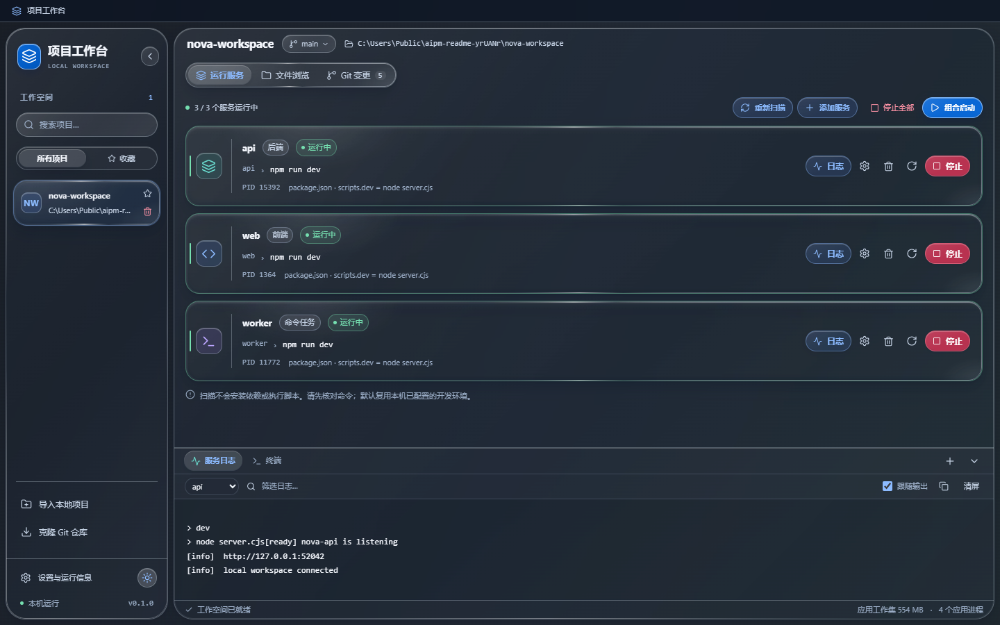
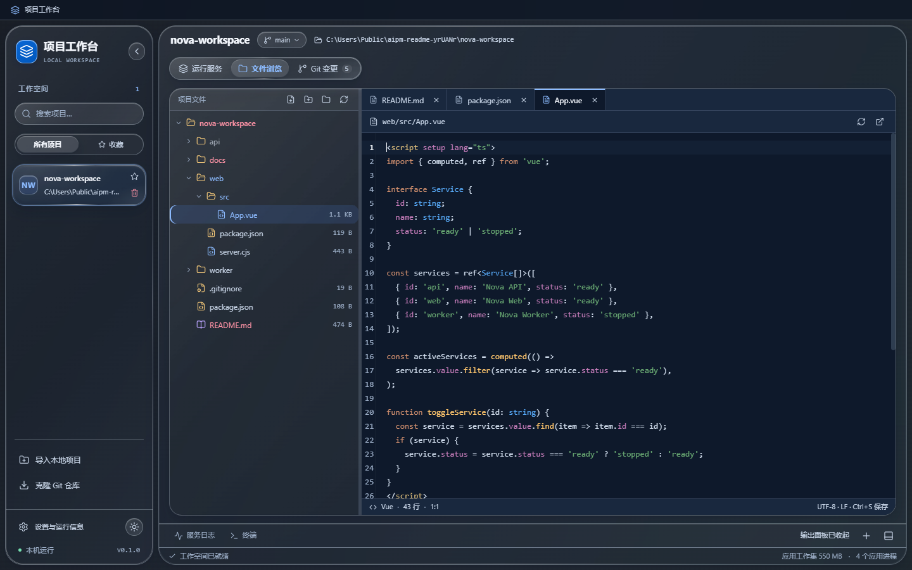
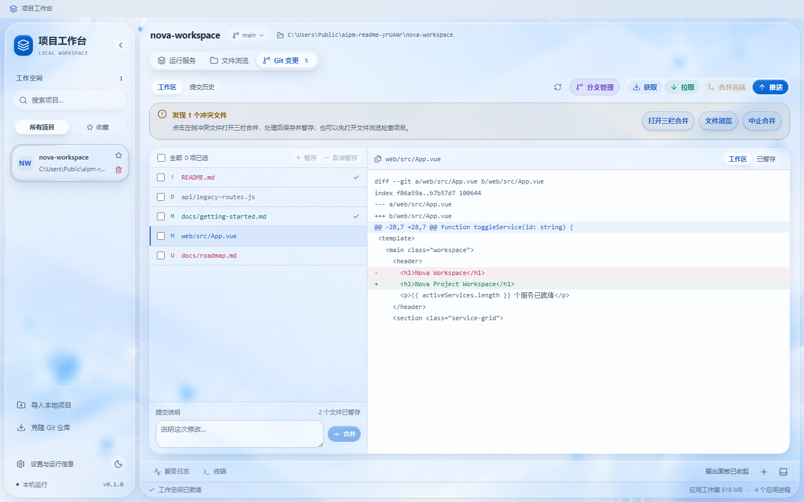
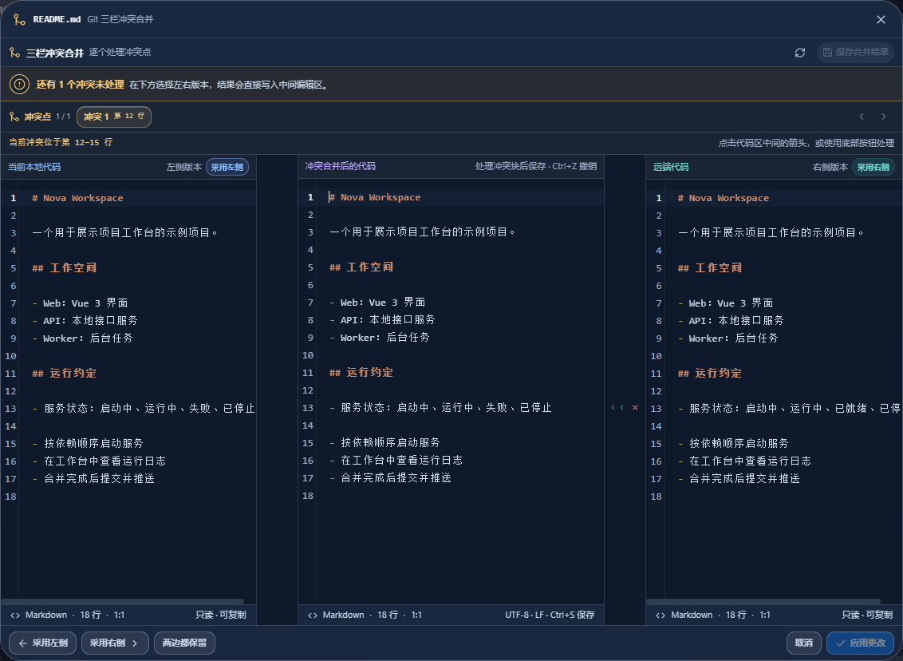

<div align="center">



# AI Project Manager · Project Workbench

**Local projects, services, file editing, and Git workflows in one desktop window.**

[简体中文](README.md) | **English**

[](LICENSE)


[Quick start](#quick-start) · [Features](#features) · [Resolve merge conflicts](#resolve-merge-conflicts) · [Contributing](#contributing)

</div>

AI Project Manager is an open-source desktop workbench for developers who maintain multiple repositories and local services. Import an existing project, review its launch commands, and manage services, logs, terminals, file editing, and Git from a single window.

The interface features glass surfaces and light and dark themes. Core functionality uses your local development environment and system Git without a model API key. AI integration is a future direction; the current version does not include model calls.



> Windows is the primary platform, with source-based development and an EXE installer build pipeline. Screenshots use an isolated demo repository. The desktop interface and screenshots are currently in Chinese; this is the English documentation.

## Why this project?

A project often includes a web client, an API, and background tasks. Daily development means switching directories and terminals, finding launch commands, and checking which services are still running.

Project Workbench brings these recurring tasks together. It remembers each repository's run configurations and provides lightweight file editing and Git merge tools alongside your usual IDE.

## Features

| Area | Capabilities |
| --- | --- |
| Project workspace | Import local directories, clone HTTPS / SSH repositories, search, favorite, switch projects, and collapse the sidebar |
| Services | Detect common project entry points, configure multiple services, start in dependency order, stop, restart, and inspect status |
| Files | Directory tree, tabbed code editing, create, copy, drop, multi-select, move to the recycle bin, and preview images |
| Git | View diffs, stage, commit, switch branches, fetch, pull, merge upstream, and push |
| Merge conflicts | Dedicated three-pane dialog, conflict navigation, accept or reject changes, edit the result, and undo actions |
| Logs and terminals | Filter, copy, and follow logs; use multiple PTY terminals and resize the output panel |
| Background operation | Close to the system tray while preserving services, terminals, and editor state; click the tray icon to restore |
| Appearance | Light and dark themes, glass panels, and distinct action colors |

### Run multiple services together

- Scan Node.js projects, FastAPI entry points, and Java project descriptors. Add custom configurations for more complex layouts.
- Configure each service's working directory, command, environment variables, HTTP readiness URL, and dependencies.
- See all services without pagination. Start individually or together in dependency order.
- Inspect live output and process state. Stop operations target process trees created by the workbench.
- Rescanning preserves existing custom configurations. Scanning does not install dependencies or run project scripts.

<details>
<summary>View the dark theme</summary>



</details>

### Browse and edit files



- Expand folders on demand and navigate with the keyboard. Drag the divider to resize the tree and editor.
- Open files in separate tabs with syntax highlighting, line numbers, bracket matching, and indentation.
- Edit directly and press `Ctrl+S` to write to disk. Switching tabs preserves drafts, cursor positions, and editor undo history.
- Create files and directories from the toolbar or context menu. A selected folder is the creation target; a selected file uses its parent folder.
- Copy, paste, and drop files or directories. Dragging copies the source; name collisions can create a renamed copy or be skipped.
- Multi-select with `Ctrl` and `Shift` for batch copy, drag, or deletion. Deletion requires confirmation and moves items to the system recycle bin.
- Preview PNG, JPEG, GIF, WebP, BMP, ICO, AVIF, and SVG images with zoom, original size, and fit-to-window controls. Images are read-only.

### Everyday Git workflows



Click the branch name in the project header to search and switch local branches. Review changes, stage selected files, write a commit message, and push. Commit history uses pagination.

The file tree and Git list share the same status colors:

| Color | Status |
| --- | --- |
| Red | Untracked files; conflicted files also have a conflict indicator |
| Green | Staged files with no subsequent working-tree edits |
| Blue | Tracked files with unstaged edits, including edits made after staging |
| Gray | Deleted files |
| Normal text | Unchanged files |

Pull is fast-forward only. When local and upstream histories diverge, use **Merge upstream** (`合并远端`) to fetch and merge upstream commits. Git uses system credentials; the app does not automatically force-push or discard local changes.

## Resolve merge conflicts



When a merge produces conflicts, the Git workspace lists the affected files. Click a file or **Open three-way merge** (`打开三栏合并`) to resolve it in a separate dialog:

1. **Local content is on the left, incoming content on the right, and the editable result in the center.** Use conflict navigation to move between pending blocks.
2. Click `>>` / `<<` to accept a change into the result. Click `×` to reject that side's change while keeping the current result. The footer also provides **Accept left**, **Accept right**, and **Keep both**.
3. Horizontal and vertical scrolling are synchronized across the panes. Undo merge actions with `Ctrl+Z`; redo with `Ctrl+Y` or `Ctrl+Shift+Z`.
4. Once conflicts are resolved, click **Apply changes** (`应用更改`) to save and stage the file.
5. After resolving all affected files, return to the Git workspace, commit the merge, and push.

If a push is rejected because upstream has new commits, follow **Merge upstream → resolve conflicts → commit the merge → push**. Use **Abort merge** (`中止合并`) to cancel the entire merge when needed.

## Quick start

### Windows x64 installer

Run `AIProjectManager-VERSION-Setup-x64.exe` and follow the wizard. Launch the app from the Start menu, or select the optional desktop shortcut. Installation defaults to the current user's application directory and does not require administrator privileges.

The installer includes Electron, the UI assets, and PTY components. Opening the workbench does not require Node.js or a Vite server. Git operations still require system Git, and project commands need their corresponding runtimes. Uninstalling does not explicitly remove project preferences or user repositories.

Build installers locally into `release/` using the [Windows packaging guide](docs/packaging.md). Code signing is not configured yet, so Windows may show an unknown-publisher prompt.

### Requirements

- **Windows** is the primary platform. Other platforms have not received equivalent validation.
- **Node.js and npm**: Node.js 22.12 or later is recommended to meet the current Vite dependency requirements.
- **Git** on your system PATH, with credentials or SSH keys configured for remote access.
- **Your project's runtime**, such as Python / uv or Java. The workbench uses existing installations.

### Run from source

```powershell
git clone https://github.com/lyunsheng051-png/ai-project-manager.git
cd ai-project-manager
npm ci
npm run dev:desktop
```

The first installation requires network access to download Electron. Once dependencies are installed, you can also double-click `start.cmd` in the repository root.

A standalone desktop window opens. The development launcher selects an available local port for the UI server. Closing the window hides it to the system tray, preserving running services, terminals, and unsaved edits. Click the tray icon or open the shortcut again to restore the window.

To quit completely, choose “退出工作台” (Exit Workbench) from the tray context menu or use the exit button in Settings. The app checks for unsaved changes before stopping its managed services and terminals. In development, the UI server also stops when the app exits.

### First session

1. Import an existing project directory or clone a Git repository.
2. Review the detected service directories and commands. Add environment variables and dependencies as needed.
3. Open a project terminal and install the target project's dependencies.
4. Start services and inspect the logs. Open additional terminals as needed.
5. Edit files in the file browser, then review, stage, and commit changes in the Git workspace.

Windows service commands and interactive terminals use `cmd.exe` by default. Run `powershell -NoProfile` inside a terminal if you prefer PowerShell.

## Shortcuts and controls

| Action | Shortcut or location |
| --- | --- |
| Save the active text file | `Ctrl+S` |
| Undo / redo | `Ctrl+Z` / `Ctrl+Y` or `Ctrl+Shift+Z` |
| Create a file or folder | `Alt+Insert` in the file tree, toolbar, or context menu |
| Select individual items / a range | `Ctrl+click` / `Shift+click` |
| Add a selection range | `Ctrl+Shift+click` |
| Select all visible tree entries | `Ctrl+A` in the file tree |
| Copy / paste files | `Ctrl+C` / `Ctrl+V` in the file tree |
| Delete selected files or folders | `Delete` in the tree; confirmation moves items to the recycle bin |
| Switch local branches | Click the branch name in the project header |
| Resize panels | Drag the file divider or output panel's top divider; double-click to reset |
| Switch theme | Sun / moon button at the bottom of the sidebar |
| Hide to tray / restore | Window close button or `Alt+F4` / click the tray icon or open the shortcut again |
| Quit completely | Exit Workbench in the tray context menu or Settings |

## Development

Built with Electron, Vue 3, Vite, and TypeScript. Code editing uses CodeMirror 6, terminals use xterm.js and node-pty, and Git operations call the system Git CLI.

### Commands

| Command | Purpose |
| --- | --- |
| `npm run dev:desktop` | Start the desktop development environment |
| `npm run desktop` / `npm run dev` | Equivalent desktop launch aliases |
| `npm run dev:web` | Browser UI preview without desktop file, Git, or PTY capabilities |
| `npm run package:win` | Compile release resources and create a Windows x64 installer using Inno Setup 6 |
| `npm run typecheck` | Check Vue, shared contracts, and Electron main-process types |
| `npm test` | Core behavior tests using isolated temporary projects |
| `npm run test:desktop` | Desktop automation scenarios |
| `npm run test:desktop:launch` | Desktop launcher checks |

Vue changes support hot updates. Restart the client after modifying `electron/` or `shared/`. The launcher transforms the main process and serves the UI through Vite; a production frontend build is not required.

### Repository layout

```text
electron/
  core/                 Path boundaries and task queues
  repositories/         Local project and appearance storage
  services/             Scanning, files, Git, service processes, and PTY
  main.ts               Desktop lifecycle and IPC handlers
  preload.cjs           Isolated desktop bridge
resources/              Logo artwork and Windows application icons
shared/                 Main-process and renderer contracts
src/
  api/                  Desktop API calls
  components/           Projects, services, Git, files, and terminals
  composables/          Workspace state, file tabs, selection, and layout
  config/               Display mappings and static configuration
  layouts/              Application shell
  router/               Routes
  styles/               Themes, design tokens, and component styles
  types/                Frontend type exports
  views/                Workspace and settings
scripts/                Launch, icon export, and automation scripts
installer/              Inno Setup installer configuration
tests/                  Core behavior tests
docs/                   Architecture notes and screenshots
```

See the [architecture notes](docs/architecture.md) and [verification records](docs/verification.md), currently in Chinese. Historical results do not imply that every subsequent change has been verified.

## Contributing

Bug reports, feature discussions, and pull requests are welcome through [GitHub Issues](https://github.com/lyunsheng051-png/ai-project-manager/issues).

- **Report a bug**: include your operating system, Node.js version, launch method, reproduction steps, and error output. Remove credentials and sensitive paths from screenshots and logs.
- **Suggest a feature**: explain your workflow, the current friction, and the behavior you would like.
- **Submit code**: create a focused branch in your fork and describe the change and relevant checks in the PR. Repository conventions are documented in [AGENTS.md](AGENTS.md).
- **Changes involving files, Git, or processes**: use temporary demo projects and avoid destructive operations on real repositories. Do not commit logs, runtime caches, personal configuration, or secrets.

## Data and current limitations

- Projects are stored in `projects.json` under Electron's `userData` directory. Service environment variables are currently stored locally in plaintext. Appearance preferences are also local.
- Removing a project record does not delete its directory. File deletion uses the system recycle bin, with no permanent-delete fallback.
- Text editing supports UTF-8 files up to 1 MB, preserves BOM and line endings, and checks for external edits before saving. Images are read-only with a 20 MB preview limit.
- File copying does not overwrite or merge existing same-name directories. Symbolic links and Git-internal paths are restricted. File renaming, full language services, and breakpoint debugging are not currently available.
- Log and terminal buffers are bounded. Complete history is not guaranteed across restarts, and process recovery after force-quitting the app is outside the current scope.
- The graphical merge tool handles text conflicts. Use system Git or an external tool for binary files and complex rename conflicts. Rebase, force-push, and built-in hosting-account login are not provided.
- Memory metrics sum Electron process working sets and may count shared pages more than once. Project service processes are excluded, and no fixed memory target is promised.

## Logo and application icons

The project logo combines blue glass workspace layers with a mint service-status node. The same icon is used in the documentation, sidebar, title bar, browser tab, and Electron window.

- [Original transparent PNG](resources/logo.png)
- [256 × 256 application PNG](resources/icon.png)
- [Multi-resolution Windows ICO](resources/icon.ico): 16, 20, 24, 32, 40, 48, 64, 96, 128, and 256 pixels
- [Individual PNG sizes](resources/icons), including a 512-pixel version

Re-export the icons after updating the source artwork:

```powershell
uv run scripts/export-icons.py
```

The Windows packaging pipeline embeds `resources/icon.ico` into the application executable, installer, and shortcuts. See the [asset notes](resources/README.md) and [Windows packaging guide](docs/packaging.md).

## Roadmap

- Release distribution, code signing, and an improved upgrade experience.
- More project detection rules and reusable service templates.
- Further improvements to Git merge interaction, file management, and larger workspaces.
- Optional AI assistance for configuration suggestions, log diagnosis, and commit-message drafts, while keeping core features usable independently.

These are planned directions, not release commitments. Follow the repository and issue discussions for progress.

## License

Licensed under the [MIT License](LICENSE). Use, modify, and redistribute with the license and copyright notice preserved.
